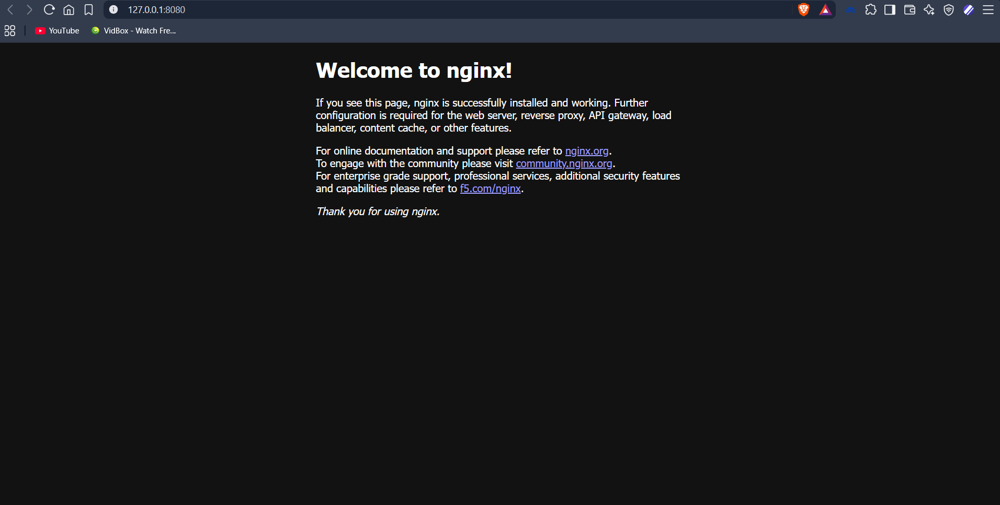

### Check svc, deploy and nodeport are working 
k port-forward service/web-server-nodeport 8080:80



### Simulate load
1- 
``` bash
kubectl apply -f https://github.com/kubernetes-sigs/metrics-server/releases/latest/download/components.yaml
kubectl patch -n kube-system deployment metrics-server --type=json \
  -p '[{"op":"add","path":"/spec/template/spec/containers/0/args/-","value":"--kubelet-insecure-tls"}]'
```
2- Run 3 busyboxes 1-3
``` bash
kubectl run -i --tty load-generator-1 --rm --image=busybox:1.28 --restart=Never -- /bin/sh -c "while true; do wget -q -O- http://web-server; done"
```

3- 
``` bash
watch -n 1 kubectl get hpa php-apache
```

